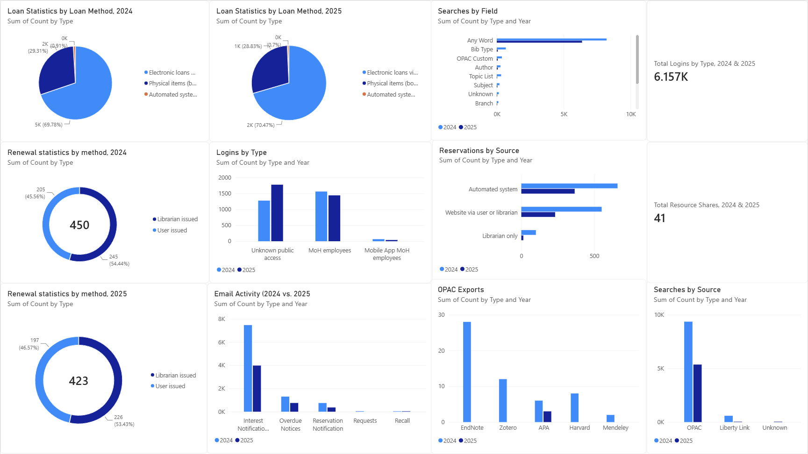
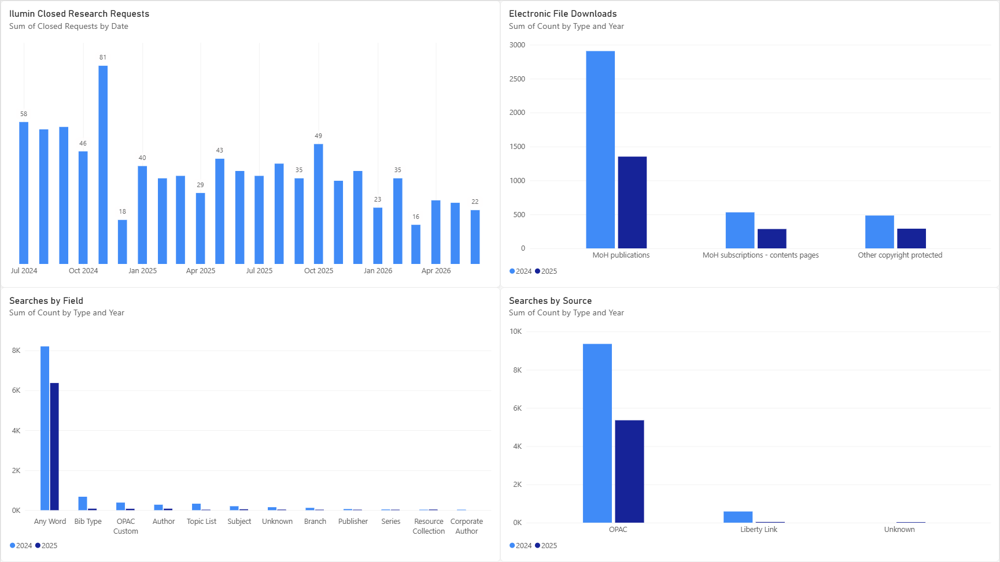
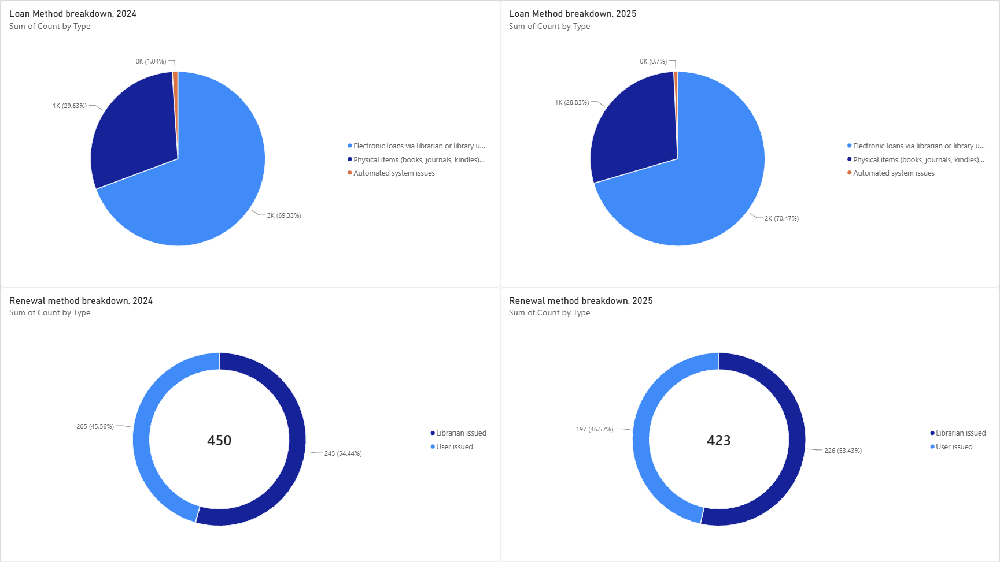
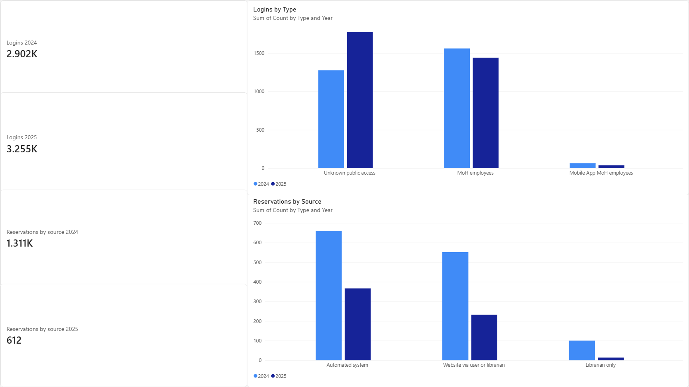

# Library Usage Dashboard

A Power BI dashboard and reporting template built for a government health library, as a university capstone project.

## The problem
The library collected a lot of usage data (loans, renewals, searches, logins, reservations), but it sat in separate exported reports. Staff had no easy way to compare years or spot trends. Our sponsor asked for a clear picture of current usage and a way to repeat the reporting in future years.

## What we built
- A four-page Power BI dashboard comparing 2024 and 2025 usage
- An Excel workbook that feeds the dashboard, with one clean table per report section (Year, Type, Count)
- A short user guide so library staff can update the data and build their own charts

## My role - Project Analyst
- Restructured the Excel tables when the sponsor changed the category headings late in the project, then repaired the Power BI data connections so the dashboard refreshed correctly
- Built and formatted visuals including bar, pie, donut, line and card charts, and fixed issues like wrong aggregations and misread dates
- Wrote the Power BI user guide for library staff
- Presented the dashboard walkthrough to the sponsor's team and our class

## Tools
Power BI, Power Query, Excel

## Dashboard pages
**Main dashboard**

An overview of every data source in one place.

**Search and discovery**

Research requests, file downloads, and how people search.

**Loans and renewals**

How items are borrowed and renewed, compared across years.

**Logins and reservations**

Who accesses the system and how reservations are made.

## What we found
- Most searches were simple keyword searches rather than specific fields like author or subject
- Renewals and logins stayed steady between years while loans fell
- Most activity went through the self-service online catalogue, with a smaller share handled only by librarians

## Challenges
When the sponsor renamed the category headings late in the project, the renamed Excel sheets broke the Power BI queries. I fixed each query's navigation step in Power Query and checked every chart afterwards. I also found that dates like "Jul-24" were being read as the current year, and fixed it by storing them as full dates.

## Note on data
This repo contains sample data in the same structure as the original. No real client data is included.
